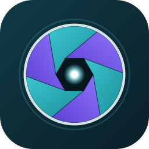
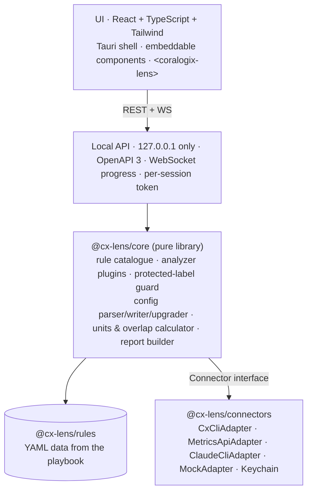

# Coralogix Lens



**A clear view of which telemetry is worth keeping.** Coralogix Lens automates the *Telemetry Health & Value Review – TAM Playbook*: a proactive posture review across logs, traces and metrics. It runs the playbook's discovery queries, respects the protected Infrastructure Explorer labels, drafts collector and Helm changes, sizes the impact in Coralogix units, upgrades out-of-date configs, and writes the customer-ready report phased into Quick Wins → Coordinated → Strategic.

It follows the playbook's method honestly:

| Stage | Who | What Lens does |
|---|---|---|
| **Assess** | Automated | Read-only queries (cx `--read-only`), Metrics API, config analysis. Nothing changes in the customer's environment. |
| **Verify** | TAM + customer | One card per finding with evidence, units, and the verify checklist. Status: Candidate → Verified / Rejected / Needs scoping. |
| **Remediate** | TAM + customer | Only **Verified** findings reach the generated config and the customer report (or a TAM override with a DRAFT watermark). |

---

## Quick start

```bash
npm install
npm run build          # core, connectors, api, cli, ui
npm test               # 42 unit/golden/upgrade/overlap tests (Vitest)
npm run e2e            # full UI flow in Chromium, light + dark (Playwright)

# Try it without an account (recorded, anonymised data):
node apps/cli/dist/index.js analyze --demo --config fixtures/configs/helm-values-old.yaml --verify all --out ./demo-report

# Open the app in a browser (the API serves the UI on 127.0.0.1 only):
npm run serve          # → http://127.0.0.1:4319
```

### Prerequisites

| Tool | Needed for | Install |
|---|---|---|
| Node.js ≥ 20 | Engine, API, CLI | nodejs.org |
| **cx** (Coralogix CLI) | Discovery queries, metrics (PromQL via `cx metrics query`), usage, TCO/SLO/E2M reads. Lens uses cx’s own sign-in (OAuth or API key, Keychain or file) and never reads the key | `brew install coralogix/tap/cx`, then `cx profiles add <name> --region <r>` ([docs](https://coralogix.com/docs/external/cx-cli/)) |
| claude (Claude Code CLI), optional | AI review of masked log samples; skill plugins | Claude Code docs |
| helm, optional | Rendering Helm values to validate final collector configs | helm.sh |
| otelcol-contrib, optional | `otelcol-contrib validate` on generated collector configs | Not in Homebrew. Download from the [releases page](https://github.com/open-telemetry/opentelemetry-collector-releases/releases) ([official macOS steps](https://opentelemetry.io/docs/collector/install/binary/macos/)): `curl --proto '=https' --tlsv1.2 -fOL https://github.com/open-telemetry/opentelemetry-collector-releases/releases/download/v0.163.2/otelcol-contrib_0.163.2_darwin_arm64.tar.gz && tar -xvf otelcol-contrib_0.163.2_darwin_arm64.tar.gz otelcol-contrib && sudo mv otelcol-contrib /usr/local/bin/` (Intel: `darwin_amd64`) |
| Rust + Tauri CLI | Building the macOS app | `npm run desktop:build` on a Mac |

Coralogix access needs **read** permissions only, as the playbook requires. Sign in once with `cx profiles add` (OAuth or API key); Lens needs nothing else.

## CLI

```bash
cxlens analyze --pillars universal,logs,traces,metrics --team <cx profile> --region ap1 \
  --config ./values.yaml --deployment helm --otel-version 0.98.0 --chart-version 0.0.300 \
  --customer "Acme" --env prod --prepared-by "Jane TAM" --critical checkout,payment \
  --internal-terms "jane,acme-internal" --out ./report
cxlens doctor --team <profile>      # cx / claude / Metrics API / latest versions
cxlens versions --refresh           # latest Helm chart + OTel Collector (24 h cache)
cxlens recheck --team <profile> --before ./report   # 24 h post-change label re-run, before/after series
cxlens teams add <name> --region ap1                 # stores CX_API_KEY in the macOS Keychain
```

Useful flags: `--window 24h|7d` (volume checks, 1h to 7d), `--dup-window 15m` (duplicate checks, 1 to 60 min), `--row-limit 200`, `--span-metric db_calls_total`, `--verify all|LOG-1,SPAN-2`, `--state verify.json`, `--allow-draft`, `--near-renewal`, `--no-verify-team`, `--record fixture.json`.

### Investigate with Claude (data-driven findings)

The playbook checks find known patterns. **Investigate** looks at what the customer’s data actually is:

1. **Discover (cx):** rank the log patterns (by body bytes), span operations (by count) and metrics (by series, see below) that drive the most volume in the window.
2. **Sample (cx):** pull live records for each, and mask them on this Mac (emails, IPs, tokens, keys, card numbers, account IDs).
3. **Analyse (Claude):** `claude -p` with the prompt on stdin, `--tools ""` (Claude can only read and reply), `--no-session-persistence`, and `--json-schema` so the answer is structured. For each contributor Claude explains what it is and its value, and proposes one change: fix at source, replace, truncate, drop, sample, move tier, or keep. It writes the OTTL and a DataPrime filter for the affected records.
4. **Validate (Lens, never Claude):** check the OTTL (allowed functions, quoting, protected labels; `otelcol-contrib validate` when installed). Run the DataPrime filter with cx to measure the matched records per day and the share that are errors (a drop that would touch errors is rejected). For drops, fetch records the filter really selects. For replace and truncate, apply the change to the live samples to show a real before/after.
5. **Quantify (Lens):** savings from measured volume × official unit rates (for truncation, the exact bytes over the limit; for replace, the bytes removed on the samples × matched records). Unvalidated suggestions are shown as *Needs scoping* with no saving claimed. Playbook log rules that cover the same data are kept visible but left out of the combined total.

**Metrics** (when the Metrics pillar is selected):

1. **Rank** metrics by series (an instant `count by (__name__)`; `*_over_time` functions drop the metric name, so ranking cannot use them).
2. **Measure each top metric over the window** with cx: distinct series over the window (this is where restart churn shows), and distinct values per label, to find the label that drives cardinality. Masked live series are kept as samples.
3. **Claude** proposes one change per metric: drop a label, normalise IDs inside a label, fewer histogram buckets, drop the metric, or fix at source.
4. **Lens validates with PromQL**: exact series after dropping a label (`count(count without (label) (…))`), the regex applied to every real label value for normalisation, real bucket counts for histograms. It refuses protected labels (including underscore forms such as `cloud_region`) and anything your alerts or recording rules reference.
5. **Saving:** series removed ÷ all metric series × metrics GB per day × the official rate (30 GB = 1 unit). This assumes series send similar numbers of data points, and the report says so.

**TAM skills** from the playbook’s AI Skills tab run as part of metrics Investigate, using copies bundled in `skills/` (override with `CXLENS_SKILLS_DIR`):
- `span-name-cardinality-analyzer`: Lens collects `span_name` values per top service through cx. Claude applies the skill and returns patterns plus OTTL. Lens applies the patterns to every real span name and reports unique names before → after.
- `span-metrics-bucket-optimizer`: Lens pulls the live bucket distribution for the top services, computes p50/p95/p99 itself (as `histogram_quantile` does), and passes the vendor you choose. Claude proposes buckets. Lens reports the histogram series change and writes `histogram.explicit.buckets` for the spanmetrics connector.

The skills normally ask for an API key and call the Metrics API with curl. Inside Lens they don’t: Lens gathers the data read-only through cx, and Claude runs with tools off. Switch each skill on or off on **Choose pillars**; CLI: `--vendor <name>`, `--no-skills`.

Each Investigate finding in the app and in every report shows the live samples, the before/after, the proposed transform, the validation query and result, the savings maths, and a DataPrime query to open those records in Coralogix. On by default on the **Choose pillars** step (5, 8 or 12 contributors); CLI: `--investigate [n]`. **Check prerequisites** on Connect confirms cx, team access, metrics, and that the claude CLI is signed in.

### Analysis window

Set on the **Config and versions** step (or with `--window` / `--dup-window` / `--row-limit` in the CLI):

| Setting | Options | Default |
|---|---|---|
| Volume checks (attribute sizes, noisy logs, spans, metric series) | Last 1 hour, 6 hours, 24 hours, 3 days, 7 days, **or a custom date and time range** (1 hour to 7 days, ending in the past) | Last 24 hours |
| Duplicate checks (`logid` seen more than once) | 5, 15, 30, 60 min | 15 min |
| Rows per query | 100, 200, 500, 1000 | 200 |

**Custom date and time:** pick a start and end in your local time (quick picks: Yesterday, Last 7 full days, Same 24 h last week). The app shows the UTC equivalent and checks the range. Logs and spans are queried with the exact start and end, duplicate checks and field samples use the final minutes of the range, and metrics are evaluated at the range’s end. CLI: `--from 2026-10-24T00:00:00Z --to 2026-10-25T00:00:00Z`.

Results are always converted to a per-day figure. Usage (the daily baseline, GB per day and units-per-GB rate) uses the **last 7 complete days**: today is left out because it is still in progress. Samples used only to see which fields exist stay at 1 hour. Every report states the window it is based on, and drafts remember the setting.

### Metric labels and cardinality

When the Metrics pillar is selected, Lens builds a **label inventory**: every label ranked by usage, flagged as *high cardinality* (e.g. `span_name`, `http_url`, `url_full`, `db_statement`), *churn* (pids, pod and container IDs) or *same value everywhere* (one value on hundreds of metrics). Protected labels and labels Coralogix features rely on are shown but never suggested for removal.

- **Exact usage (optional):** add an API key with the **DataAnalytics** preset under *Exact metric usage* on Connect. Give it a name; it is stored in the macOS Keychain and offered from a dropdown next time (per team, so one key can serve several teams). Lens keeps only key names and team choices in `~/.cxlens/usage-keys.json`. **Test key** confirms it works; `CXLENS_USAGE_KEY` overrides for the CLI. Lens then reads the Coralogix **Metric Usage API** (gRPC, read-only; message definitions bundled in `packages/connectors/proto`), the same data as Settings › Metrics Data › Labels, and uses exact units per label and per metric. Without it, Lens measures labels with PromQL through cx and estimates savings from series.
- **Value shapes:** for each flagged label Lens fetches every value and groups them by shape (GraphQL text → operation name, URLs → route with IDs replaced, numbers and quoted strings stripped), with masked real examples.
- **Built-in tested fixes:** for GraphQL text in span names (→ operation name) and IDs, UUIDs and query strings in URL labels (`http_url`, `url_full`, …), Lens writes the OTTL itself (span context, before the spanmetrics connector) and tests it on every value, so a transform exists even without Claude. When Claude’s patterns leave as few or fewer distinct values, Lens uses Claude’s instead. The labels table shows each tested fix (“16,557 → N values”), marked “pending verification” until the finding is verified.
- **Fix per label:** Claude proposes a normalisation, a drop or a source fix; Lens applies normalisations to every real value and reports the exact distinct values after, measures drops with `count without`, and refuses protected or alert-referenced labels.
- **Span metrics are found by the `span_name` label** (the costliest one is used), and metrics are ranked by real units or by series over the window.
- Reports add a **Top cardinality and usage labels** table; the slide's “Next prize” names the biggest label. Checks that found no data are listed on Verify and in the internal report.

### Several deployment types

On **Customer context**, tick every way the customer runs the collector: Kubernetes (EKS or any cluster, Helm), ECS, EC2, Standalone. **Config and versions** then shows one optional config slot per type, each with its own detection, versions and a warning if the file looks like the wrong type.

- Data checks run **once** for the whole team, so savings are never counted twice. Config checks run **per type** (e.g. “ECS: Upgrade to the latest …”).
- A finding has one Verify decision and a config change per type (a Helm preset for Kubernetes, a processor for ECS/EC2).
- Exports have a folder per type: `kubernetes/`, `ecs/`, `ec2/`, `standalone/`, each with its optimised config, diff, and (when behind) upgraded config and breaking changes.
- Reports show version status per type, “Applies to” on each finding, and the share of log and span volume per type (from `k8s.cluster.name` and `cloud.platform`).
- CLI: `--deployment helm,ecs,ec2` and `--config helm=values.yaml --config ecs=ecs.yaml`.

### Report layout

Every HTML report (customer and internal) opens with a **one-slide leadership summary**, then a **Technical details** part.

- **The slide (16:9, “Present full screen”, Esc to exit):** units per day the customer can stop spending; today → after; per month (× 30) and per year (× 365); the quick-win share; the cut per data type; the largest changes; a “Next prize” callout when one data type is at least 40% of usage with under 5% saved; baseline dates and the ±20% caveat.
- **The same numbers as the rest of the report:** they come from the same overlap-safe total, and the “largest changes” list only includes changes the total counts, so it never adds up to more than the headline.
- **Draft reports** say so on the slide.
- **Audience:** set who the slide is for on the Customer step, or with `--audience` (default “leadership”).
- **Technical details** follow: stat tiles, roadmap, ranked opportunities, usage trend, upgrade, findings, expansion and next steps. Markdown reports carry the same summary as text at the top.

### Drafts, starting over and file names

- **Save a draft at any stage** with *Save draft* in the sidebar (or ⌘S). The draft holds the customer details, pillars, config, versions, current step and the assessment with its Verify decisions, and keeps saving as you move on. Resume or delete drafts from **Connect**. Drafts live in `~/.cxlens/drafts` on this Mac and never contain API keys.
- **Start a new review** (sidebar, and at the end of Remediate) returns to Connect with everything cleared, offering to save a draft first.
- **Download all** at the end gives one zip with every report and config. *Download all as draft* includes unverified findings and marks every report DRAFT. Via the CLI: `--zip` (with `--allow-draft` for the draft version).
- **Reports are named after the customer**: `Acme.html`, `Acme.md`, `Acme.json`, `Acme (internal).html`, and `Acme (draft).html` / `Acme (internal, draft).html` for drafts. Characters that are not allowed in file names are removed.

### Outputs

| File | What it is |
|---|---|
| `<Customer>.{html,md,json}` | Customer-ready report (schema: `packages/core/schema/report.schema.json`). Internal names, Notion/Slack/Drive/Gong links, account IDs, keys and team hostnames are stripped, then checked again before export. |
| `<Customer> (internal).{html,md,json}` | Same report plus sources, queries, raw evidence, skipped checks. |
| `optimized-config.yaml` + `.diff` | Customer's config on their current version with Verified findings applied; structure, order and comments kept; every added block tagged with finding ID and source link. |
| `upgraded-config.yaml` + `.diff`, `breaking-changes.md` | Only when out of date: moved to the latest version, breaking changes auto-fixed where mechanical, everything else listed as *Manual action needed*. |
| `tco-policy-drafts.json` | TCO log/trace policy drafts (never created automatically). |
| `calls_total_ALL_SERVICES_unique_labels.csv` | Built-in Metrics Label Analyzer export. |

PDF: open the HTML report and print to PDF (the desktop app does the same through the system print dialog).

## Architecture



```
packages/core        engine (no UI or OS code)      packages/rules   rule catalogue (YAML)
packages/connectors  cx · Metrics API · claude · mock packages/api     local server + OpenAPI
packages/ui          app + lib + web component      apps/cli         `cxlens`
apps/desktop         Tauri macOS shell              fixtures         demo data + sample configs
brand                logo sources                   scripts          icon build
```

**Safety by construction**
- *Protected labels* (`cloud.*` listed, `host.id/name/image.id/type`, `azure.*`, `gcp.*`) live in one file, `packages/rules/protected-labels.yaml`. The writer refuses any op that deletes one. It strips them from existing denylists, `delete_key` statements and `attributes`/`resource` delete actions, and a final guard re-scans every output. It never uses the chart's default denylist: a custom denylist **replaces** the default, so it always writes the full protected-safe list.
- *Read-only*: every cx call carries `--read-only`; the Metrics API adapter only uses GET; TCO, recording rules and E2M are drafts.
- *Secrets*: Lens never handles the customer's key. Logs, traces, metrics and usage all go through cx, which authenticates itself. Only the optional direct Metrics API fallback takes an explicit key (`CX_API_KEY` or Lens's Keychain entry `com.coralogix.lens`), and it is never written or logged.
- *AI*: samples are masked (emails, IPs, tokens, keys, card numbers, account IDs) before reaching `claude -p`, and the UI shows exactly what will be sent.
- *Limits*: every query has a time window and a row limit. A global throttle plus `Retry after` handling protects the API.

## Extending

**Add an analyzer.** Add the rule (queries, thresholds, verify questions, sources) to `packages/rules/<pillar>.yaml`, then a plugin:

```ts
import { definePlugin, loadCatalogue } from '@cx-lens/core';
export const myCheck = definePlugin(loadCatalogue(), 'LOG-MY-CHECK', 'logs', {
  async detect(ctx) { const e = await ctx.query('LOG-MY-CHECK', 'my-query'); return e.rows?.length ? { applicable: true, evidence: [e], facts: { n: e.rows.length } } : null; },
  recommend: (d) => ({ nextStep: 'What the customer should do next.' }),
  estimateSavings: (d) => ({ kind: 'needs-scoping', unitsPerDay: null, gbPerDay: null, basis: 'Why' }),
  generateConfigPatch: () => ({ summary: '…', snippet: '…', ops: [/* processor | helmPreset | … */] }),
});
// runAssessment({ ..., extraPlugins: [myCheck] })
```

Metadata (title, phase, effort, owner, overlaps, verify checklist, sources) comes from the YAML, so playbook edits are data changes.

**Add a TAM skill** (`.skill` package from the playbook's AI Skills tab) with no code changes:

```ts
import { skillAnalyzer } from '@cx-lens/core'; import { ClaudeCliAdapter } from '@cx-lens/connectors';
const plugin = skillAnalyzer({ id: 'span-name-cardinality-analyzer', path: '~/skills/span-name-cardinality-analyzer.skill', pillar: 'metrics', title: 'Span name cardinality (skill)' }, new ClaudeCliAdapter());
```

The skill runs headless through `claude -p` with its SKILL.md appended. Its JSON output is mapped to standard findings (status Candidate, source marked internal).

**Embed the engine** in another product:

```ts
import { runAssessment, produceOutputs } from '@cx-lens/core';
import { buildConnector } from '@cx-lens/connectors';
const a = await runAssessment({ connector: await buildConnector({ name: 'acme', region: 'eu2', profile: 'acme' }), customer, pillars: ['universal','logs'], deployment: 'helm', configText });
const { files } = await produceOutputs(a);
```

You can also call the local API (OpenAPI at `/api/openapi.json`), or drop in the UI: `import { LensApp } from '@cx-lens/ui'` or `<coralogix-lens api="http://127.0.0.1:4319" token="…">` from `@cx-lens/ui/element`.

## Versions

Lens resolves the latest **otel-integration** chart at runtime from the Coralogix Helm repo (`index.yaml`) and the latest **OTel Collector** from the opentelemetry-collector-releases GitHub releases. Both are cached for 24 h; offline, the cache is used and its date shown. No version is hard-coded in logic. `0.0.356` (pinned in the playbook) is only an offline fallback.

For an outdated Helm chart, Lens maps the chart version to its collector image via the chart CHANGELOG. It then collects breaking changes between the current and latest versions from the chart, contrib and core CHANGELOGs, keeping only those that affect components in use. It auto-fixes the mechanical ones, flags the rest as manual, and rechecks the custom denylist against the chart README.

## Packaging the macOS app

```bash
cargo install tauri-cli --version '^2'   # or: npm i -D @tauri-apps/cli -w @cx-lens/desktop
npm run build && npm run icons && npm run desktop:build   # → .app and .dmg in apps/desktop/src-tauri/target
```

The shell starts the engine with the system Node (≥ 20) on a free 127.0.0.1 port and a random session token, then opens a native window on it. To ship without a Node dependency, add a Node binary as a Tauri `externalBin` sidecar and point `main.rs` at it. Signing and notarisation use your Apple Developer ID as usual.

## Status

| Milestone | State |
|---|---|
| 1 Core, rule catalogue, MockAdapter, protected-label guard | Done; tested |
| 2 Universal + Logs analyzers | Done; run live |
| 3 Config parser / writer / diff | Done; golden tests for Helm, ECS, EC2 |
| 4 Report builder | Done; template sections, internal + customer, JSON Schema |
| 5 cx, claude, Metrics API adapters | cx runs live for logs, spans, usage and metrics (PromQL); Metrics API kept as an explicit-key fallback; claude and Keychain paths written, not exercised on this build machine (Linux) |
| 6 Traces + Metrics analyzers | Done; run live |
| 7 Version check + upgrader | Done; live version resolution and changelog parsing; upgrade tests |
| 8 UI | Done; Playwright flow passes in light and dark |
| 9 Packaging | Tauri project and icons included; the macOS bundle must be built on a Mac (not compiled here) |

See **SOURCES.md** for every source used and every playbook-vs-docs difference.
